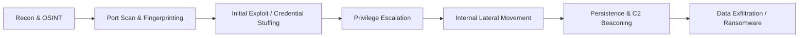
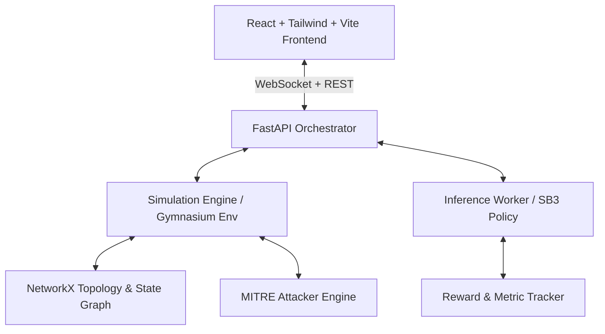

# Product Requirements Document (PRD)
## Project Name: AegisRL — Adaptive Autonomous Cyber Defense Agent

---

## 1. Executive Summary & Vision

**AegisRL** is an autonomous cyber defense decision-support and response engine powered by Deep Reinforcement Learning (DRL). Unlike static, rule-based Security Orchestration, Automation, and Response (SOAR) playbooks or threshold-based alerts (which attackers routinely evade through slow-and-low staging or lateral movement), AegisRL frames cyber defense as a **sequential decision-making problem under partial observability (POMDP)**.

The system trains an agent on simulated enterprise network topologies modeled as dynamic graphs. It learns Pareto-optimal policies that **neutralize active threats and protect mission-critical business assets** while **minimizing operational friction, false-positive disruptions, and service downtime**.

---

## 2. Problem Statement & Market Opportunity

- **Alert Fatigue & Triaging Bottlenecks**: Modern SOC teams drown in tens of thousands of daily alerts. Triage latency allows attackers an average "breakout time" of under an hour.
- **The Pitfall of Static SOAR**: Conventional automated playbooks execute brittle deterministic rules (e.g., `If IP brute-forces -> Block IP`). Sophisticated adversaries circumvent this by rotating proxies, migrating credentials, or moving laterally before containment occurs.
- **Business vs. Security Tension**: Over-aggressive defenses (e.g., disconnecting an entire subnet or rebooting core databases) halt business operations, costing millions in downtime. Under-aggressive defense risks full compromise or exfiltration.
- **Why RL?**: Reinforcement learning natively balances delayed consequences, trade-offs between business continuity and risk reduction, and proactive posture management (e.g., honeypot deployment and targeted canary credential rotation).

---

## 3. Threat Model & Attacker Behavior

AegisRL models an adversary executing a multi-stage **MITRE ATT&CK** kill chain:

### Attacker Profiles (Configurable Adversaries)
1. **Script Kiddie / Automated Scanner**: Deterministic, loud, high velocity, linear scanning, stops on blocked IPs.
2. **Stealth APT (Advanced Persistent Threat)**: Low-and-slow probing, living-off-the-land techniques, evasive jitter on C2 beacons, credential pivoting, and targeting high-value databases (Crown Jewels).
3. **Adaptive Red Team Agent**: An opposing heuristic or sub-RL agent that switches targets and paths when a node or IP is blocked.

---

## 4. Reinforcement Learning Environment Formulation (POMDP)

The environment represents an enterprise network represented as a directed graph $G = (V, E)$.

### 4.1 Topology Entities
- **External Perimeter**: Firewall / Edge Gateway, DMZ Web Servers.
- **Corporate Network**: Domain Controller (Active Directory / LDAP), Internal Subnet, Employee Workstations (HR, Eng, Sales).
- **Core Tier (Crown Jewels)**: Production Database, Secret Vaults, Backup Storage.

### 4.2 State / Observation Space ($\mathcal{S}$ / $\mathcal{O}$)
Because real defenders do not have god-mode telemetry, observations are **partially observable and noisy**:
- **Graph Topology Features (NetworkX representation)**:
  - Node Status: OS type, running services/ports, vulnerability posture (CVE severity score).
  - Telemetry: IDS alert level (0–3), failed auth counters, egress traffic volume, honeypot access flags.
  - Node Health: Service availability (Up, Degraded, Down, Isolated).
  - Business Weight ($W_v$): 1.0 (workstation), 5.0 (web server), 10.0 (database/vault).
- **Vector / Graph Encoding**:
  - Node feature matrix $X \in \mathbb{R}^{N \times d}$ + Adjacency Matrix $A \in \mathbb{R}^{N \times N}$ (usable directly by Graph Neural Networks or flattened for MLP/CNN policies).
  - Observation includes imperfect alerts: includes false-alarm noise and sensor lag.

### 4.3 Action Space ($\mathcal{A}$)
The action space is discrete or multi-discrete parameterized by `(Action_Type, Target_Node_or_Subnet)`:
1. `DO_NOTHING`: Wait and accumulate logs (zero cost).
2. `INSPECT_DEEP`: Activate verbose packet capture & memory audit on target node (minor compute cost, clarifies noisy observation).
3. `DEPLOY_HONEYPOT / CANARY`: Deploy high-interaction decoy services to bait adversary.
4. `ROTATE_CREDENTIALS`: Invalidate and refresh tokens/passwords for target identity/node (small friction cost).
5. `PATCH_VULNERABILITY`: Remediate known flaw on a service (requires temporary service restart).
6. `ISOLATE_HOST`: Drop all ingress/egress except telemetry channel (high operational cost if done to critical servers).
7. `BLOCK_IP_CIDR`: Block offending IP range at firewall boundary.
8. `ROLLBACK_RESTORE`: Restore compromised node from trusted snapshot (heavy downtime penalty).

### 4.4 Reward Function Formulation

$$R_t = R_{\text{security}} + R_{\text{availability}} + R_{\text{action\_cost}}$$

- **$R_{\text{security}}$ (Defense Success / Prevention)**:
  - $+100$ for severing attacker access or trapping in honeypot.
  - $-200$ if an attacker accesses a "Crown Jewel" database.
  - $-50$ for each uncontained compromised internal host.
- **$R_{\text{availability}}$ (Business SLA Preservation)**:
  - $-k \times W_v$ for every step a legitimate business node is isolated or disrupted.
- **$R_{\text{action\_cost}}$ (Operational Friction)**:
  - Small negative penalty per action (e.g., `-0.5` for credential rotation, `-5.0` for host isolation, `-1.0` for deep inspect) to discourage trigger-happy twitch defense.

---

## 5. System Architecture & Tech Stack

### Component Details
| Component | Technology | Role |
| :--- | :--- | :--- |
| **RL Environment** | Python 3.11, Gymnasium, NetworkX | Custom gym env (`CyberDefenseEnv-v1`) modeling state transitions, topology, and packet flows. |
| **RL Algorithms** | Stable-Baselines3, PyTorch | PPO (Proximal Policy Optimization) / MaskablePPO (action masking for invalid actions), DQN baseline. |
| **API & Backend** | FastAPI, Uvicorn, WebSockets, Celery/Redis | Serves real-time attack simulation feeds, step-by-step playback, and policy execution. |
| **Frontend UI** | React 18, Vite, Lucide Icons, React Flow / Cytoscape.js | Interactive live network topology canvas, threat timeline, alert triaging log, agent action explanation. |
| **Packaging & CI** | Docker, Docker Compose | Multi-container setup (`frontend`, `api`, `trainer`). |
| **CloudScope Synergy** | OpenTelemetry/JSON exporters | Export agent audit traces in standard security event schemas compatible with enterprise observability tools. |

---

## 6. Key Differentiating Features (Value Additions)

1. **Action Masking**: Prevents nonsensical actions (e.g., isolating a node that is already isolated or patching a service that has no vulnerabilities) via `sb3-contrib`'s `MaskablePPO`.
2. **Explainable AI (XAI) for SecOps**:
   - Computes feature attribution / SHAP values explaining *why* the agent chose `ISOLATE_HOST` over `BLOCK_IP` (e.g., *"Confidence of lateral movement = 87%, business impact threshold met"*).
3. **Benchmarking Suite (RL vs. Heuristic Baselines)**:
   - Built-in comparison against:
     - *Static Rule Engine* (Standard Snort/Suricata style).
     - *Greedy Defender* (Isolates on any alert).
     - *Passive Defender* (Human delay simulation).
   - Generates ROC curves, Mean Time to Containment (MTTC), and SLA Availability Scorecards.
4. **Interactive "Human-in-the-Loop" Mode**:
   - The UI lets a human security analyst approve high-consequence agent actions (e.g., isolating the DB) or toggle to full autonomous mode.

---

## 7. Functional Requirements

### 7.1 Environment & Simulation Engine
- Configurable JSON/YAML network definitions (nodes, subnet relationships, vulnerable ports, asset value).
- Deterministic seed generation for reproducible evaluation runs.
- Step-by-step state dump containing ground-truth vs. observable-telemetry.

### 7.2 Training & Evaluation Pipeline
- Checkpoint saving with TensorBoard logging (episode length, cumulative reward, compromise rate, downtime ratio).
- Multi-environment vectorization (`SubprocVecEnv`) for high-throughput rollout collection.

### 7.3 Web Application & Visualization
- **Live Canvas**: Nodes light up based on threat status (Green = Normal, Yellow = Suspicious, Red = Compromised, Blue = Isolated/Defended).
- **Control Bar**: Step, Play, Pause, Reset, Change Adversary Strategy (Script vs. APT).
- **Analytics View**: Live charts showing Cumulative Reward, Attacker Progress, and Business Availability %.

---

## 8. Development Roadmap & Milestones

- **Phase 1: Environment & Attacker Engine (Gymnasium + NetworkX)**
  - Implement topology graph, node attributes, transition dynamics.
  - Implement heuristic multi-stage attacker agent.
- **Phase 2: RL Training & Policy Optimization (Stable-Baselines3)**
  - Implement reward shaping and action masking.
  - Train PPO agent to outperform static baseline defenses.
- **Phase 3: Backend API & Real-time Server (FastAPI + WebSockets)**
  - Expose interactive endpoints: `/sim/reset`, `/sim/step`, `/sim/run`, `/metrics`.
  - Stream state snapshots over WebSockets at 10–30 Hz.
- **Phase 4: Modern SecOps Dashboard (React + React Flow / Cytoscape)**
  - Interactive network visualizer with dynamic node states and action logs.
  - Comparative benchmark visualization (RL vs. Rule-based).
- **Phase 5: Packaging & Documentation**
  - Docker Compose setup, pre-trained model weights, and demo recording.
